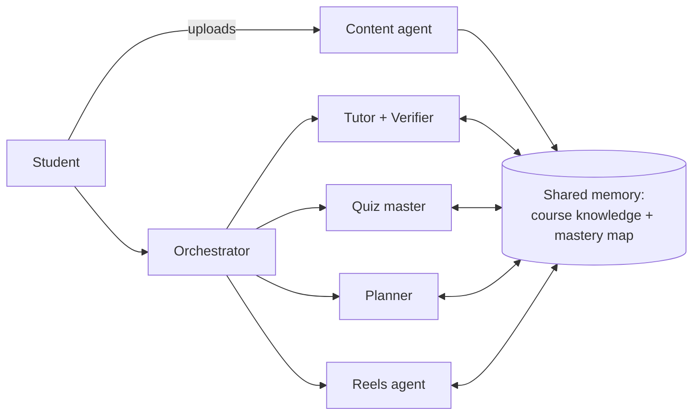

# Studeasy

**A team of AI study agents that turns your own course material into a personal study loop.**
Built for the Reply Student Tech Clash 2026.

🔗 Live: **https://studeasy.pages.dev**

Students upload their slides, PDFs and notes once. From then on, every explanation, quiz,
flashcard and reel comes from that material, and every result feeds back into what they
see next.

## What it does

| Feature | What the student gets |
|---|---|
| **Tutor** | Answers questions from the student's own notes, cites the slide or page, gives hints before answers. A verifier agent flags unsupported claims. |
| **Quizzes** | Multiple choice, true/false and open answers; open answers get partial credit and feedback. |
| **Flashcards** | Spaced repetition (SM-2): cards come back right before you'd forget them. |
| **Study plan** | Add an exam date; get a day-by-day plan built around your weakest concepts. |
| **Study Reels** (opt-in) | A swipeable feed of 30-second cards (explainers, quick quizzes, flashcard flips, myth vs fact), weakest concept first, with a break card every 15 reels. |

The **mastery map** ties it together: a 0–1 score per concept, updated by every quiz answer,
flashcard rating and quiz reel. The planner and the reels feed always start with the weakest
concepts.

## How it works



- **Content agent**: splits uploads into passages, embeds them for search by meaning, extracts key concepts.
- **Orchestrator**: decides what each chat message needs and routes it to the right agent.
- The agents are a [LangGraph](https://www.langchain.com/langgraph) graph; chat answers stream to the browser token by token.

## Tech stack

| Layer | Built with | Hosted on |
|---|---|---|
| Frontend | React, TypeScript, Vite | Cloudflare Pages |
| Backend and agents | Python, FastAPI, LangGraph | Render (Docker, Frankfurt) |
| Data and sign-in | Supabase: Postgres, pgvector, Auth, Row Level Security | Supabase |
| AI | Llama 4 Scout (chat, tool calling) and BGE-M3 embeddings on Cloudflare Workers AI's free daily allowance; Mistral and OpenAI GPT-6 Luna also supported (`LLM_PROVIDER`) | Cloudflare Workers AI |

Hosting runs on free tiers; the only running cost is AI usage.

## Repository layout

```
backend/    FastAPI + LangGraph agents, Supabase schema, tests     → backend/README.md
frontend/   React + TypeScript app                                 → frontend/README.md
render.yaml Render Blueprint for the backend
DEPLOY.md   Step-by-step hosting guide (Render, Cloudflare Pages, Supabase)
.github/    Keep-warm workflow for the free backend instance
```

## Run it locally

You need Python 3.11+ with [uv](https://docs.astral.sh/uv/) (or pip), Node.js 22, a Supabase
project and a free Cloudflare Workers AI token (dash.cloudflare.com → AI → Workers AI).

```bash
# 1. Database: run backend/supabase/schema.sql once in the Supabase SQL editor

# 2. Backend (http://localhost:8000, API docs at /docs)
cd backend
cp .env.example .env        # add CLOUDFLARE_ACCOUNT_ID, CLOUDFLARE_API_TOKEN, SUPABASE_URL, SUPABASE_SERVICE_ROLE_KEY (the secret key)
uv sync
uv run uvicorn app.main:app --reload

# 3. Frontend (http://localhost:5173), in a second terminal
cd frontend
cp .env.example .env        # add VITE_SUPABASE_URL and the publishable key; VITE_API_URL=http://localhost:8000
npm install
npm run dev
```

Tests: `cd backend && uv run pytest`, plus `uv run python scripts/smoke_test.py` for a full
end-to-end check against your running backend.

## Team

[Team name · member names]
